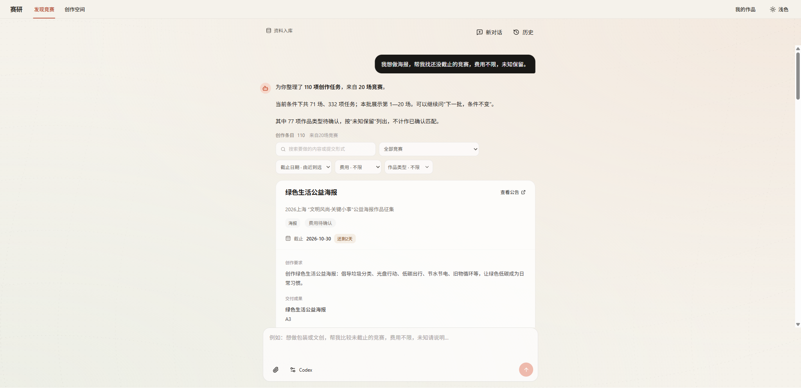

# 赛研 Saiyan

把“找到适合的设计竞赛”接到“理解任务并开始创作”的个人产品原型。

设计学习者常需要在多份征稿公告中反复确认作品类型、费用和截止日期，再把创作目标、交付规格搬到新的工具里。赛研把有来源的竞赛资料整理为独立任务卡片，并将准确任务交给创作画布，减少找赛与开工之间的信息断层。

## 核心流程

1. 描述作品方向，通过作品类型、费用、截止时间查找竞赛。
2. 查看任务卡片、创作要求、交付成果和公告来源；未知条件保留为未知。
3. 从具体任务进入 ComfyArt 画布，携带对应版本的完整创作目标。
4. 编辑、保存作品并返回原竞赛会话，继续比较与创作。



## 这个项目中的工作

- 将竞赛公告转为有版本、来源和准确任务范围的资料，避免把母赛、专项、可选投稿成果混为一张卡。
- 将候选筛选、任务阅读和画布创作接为连续流程，保存失败、缺少资料和未知条件都有明确状态。
- 在已有画布工具基础上完成任务交接、来源会话恢复和本地保存；画布基础能力来自 ComfyArt 等第三方项目。

## 先体验成品

需要 Node.js 24 或以上版本。在仓库根目录运行：

```sh
npm run preview
```

打开 [本地体验](http://127.0.0.1:3201/)，从首页进入竞赛，输入“我想做海报，帮我找还没截止的竞赛，费用不限，未知保留。”，选一项任务进入画布。也可以查找“文明出行公益海报”，查看独立制作的模拟创作案例。修改保存在当前浏览器中。

体验版不需要密钥或业务后端：竞赛查询由浏览器根据内置资料执行，文字与图片使用预先保存的案例，**不会现场调用 Agent 或生成新图**。竞赛业务日期固定为 2026-10-28，不代表今天仍可报名。不含全量个人会话和工作区。

## 查看与运行源码

- `product/`：最终本地产品源码，含竞赛 Agent、资料入库、Web、任务交接及 ComfyArt 接入。
- `demo/frontend/`：与产品共用界面基础的演示前端。
- `demo/offline/`：脱敏资料与浏览器适配层。
- `demo/site/`：可直接托管的构建成品。

重新构建体验版：

```sh
cd demo
npm --prefix frontend/web ci
npm --prefix frontend/comfyart ci
npm run build
```

完整产品的本机启动与外部依赖见 [运行说明](docs/RUNNING.md)。完整产品需自行准备模型登录、竞赛资料及 ComfyUI 环境，仓库不附带个人授权、聊天或模型权重。直接体验成品只需前面的预览命令。

## 当前边界

这是个人本地原型和作品集展示，不是已验证的多人在线服务。模型可能误解任务或遗漏条件，来源与未知状态用于辅助核对，不能代替阅读主办方最新公告。本次公开整理检查了代码、构建和固定内容主流程，没有重新进行真实模型、生图或赛事采集评测。

## 发布范围与许可

本仓库是最终产品的独立脱敏快照，私有仓库的提交历史、开发聊天、实验过程、原始评测输出、恢复备份和凭据均不随库发布。`demo/` 内的交互样例属于成品体验数据，不是完整开发记录。

第三方组件、字体和素材的权利属于各自作者，原有许可证和署名随源码保留；公开可见不代表对所有内容统一授予开源或商用许可。作者新增部分暂未另行授予开源许可。
